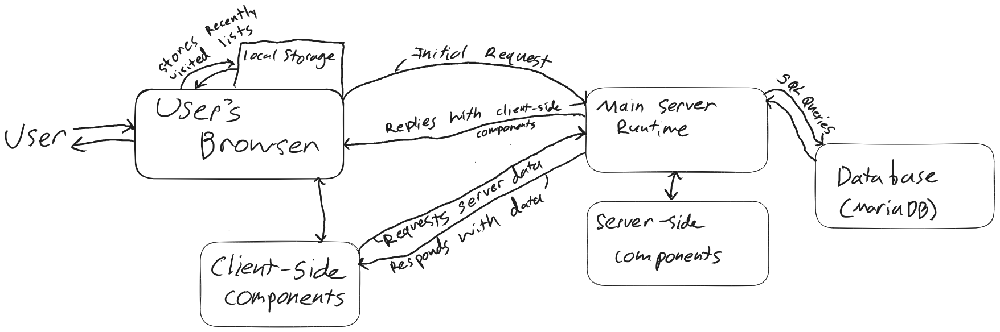

# untitledToDoLists

A basic todo list web app, made by Shane Menzies as a demonstration project.

## Basic features

The home page (/) shows you a list of the lists you've visited recently, both in the center and the sidebar, where you can also find the button to make a new list.

The list page (/list/\[listID\]) shows and lets you edit a particular list and its entries, storing all edits to the app's database.

The health page (/health) performs a basic status update on the current database connection.

## How to run

Install npm (or pnpm), then install the dependencies with `npm i`. After that the app can be run locally for development using `npm run dev`, or built and ran for deployment with `npm run build` and `npm run start`. 

```
# Install dependencies
npm i

# Run locally for development (defaults to localhost:3000)
npm run dev

# Build and run optimized version
npm run build
npm run start -- --port [PORT]
```

## Database Configuration

This app requires a MySQL-compatible database to function. The configuration for connecting to this database is set through a `.env` file, following the fields set out in the example file `.env.example`.

## Deployment Details

Using Next.js made deployment relatively simple, I have a single t3.micro EC2 instance running Amazon Linux, with a basic MariaDB configuration for the database.

## Architecture Diagram


